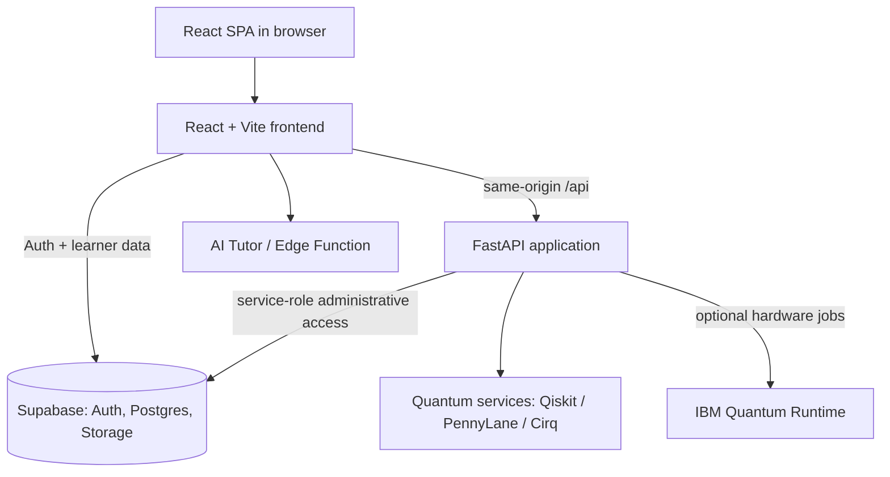

# QuantumLearn AI — Project Summary

> **Project type:** Full-stack adaptive quantum-computing learning platform  
> **Primary stack:** React + Vite, FastAPI, Supabase, Qiskit/PennyLane/Cirq  
> **Current deployment model:** One Dockerized FastAPI service serves the compiled React SPA and `/api` endpoints.

## 1. Purpose

QuantumLearn AI teaches quantum computing through a guided curriculum, interactive circuit tools, practice assessments, quantum-code execution, contests, AI assistance, and learner-progress analytics.

The application supports three principal roles:

- **Students:** complete an assessment, follow a personalized learning path, study topics, take quizzes, build circuits, join contests, and track progress.
- **Instructors:** access the instructor dashboard for supported instructional workflows.
- **Administrators:** manage users, contests, platform settings, curriculum content, challenges, achievements, projects, and announcements.

## 2. Major Capabilities

### Learning experience

- **24-module curriculum** covering foundations through advanced quantum computing topics.
- Topic lessons with video resources, documentation links, mathematical formulas, quizzes, and selected circuit challenges.
- Initial knowledge assessment and adaptive roadmap generation.
- Progress, skills, module/topic completion, XP, streaks, achievements, and skill-map views.
- Circuit Builder with browser-side simulation, probability visualizations, and Bloch-sphere support.
- Quantum Lab for executing supported quantum-framework source code.
- Classical-versus-quantum comparison experience and project-oriented learning activities.
- AI tutor with server/edge-function integration where configured and a fallback response path.

### Contests

- Scheduled quantum coding and circuit-building contests.
- Server-side contest lifecycle: `upcoming`, `live`, and `ended`.
- Submission limits and resubmission controls controlled by platform settings.
- Correctness and efficiency scoring; eligible best solutions can be queued for IBM Quantum hardware-fidelity verification.
- Leaderboards and post-contest rating finalization.
- Admin creation and editing of contest metadata, including title, description, start/end time, and rating status.

### Administrative content management

The Admin Dashboard covers:

- Modules
- Topics
- Resources
- Questions
- Circuit challenges
- Coding challenges
- Achievements
- Projects
- Announcements
- Contests, users, platform settings, audit logs, and dashboard metrics

Most admin-managed content stores flexible per-item fields in `metadata JSONB`, enabling feature-specific configuration without schema changes for every new field.

For topics, the Admin Dashboard supports editing:

- Video lecture URL
- Documentation/resource URL
- Formula text
- Topic quiz questions, options, and correct answers
- Difficulty, module/track, duration, concepts, and lab suggestions

### Admin-to-student topic synchronization

Student module pages begin with the built-in curriculum data, then merge published topic overrides loaded from Supabase or the backend topic-content endpoint. Topic overrides can update the student-facing:

- Watch/video link
- Documentation link
- Formula display
- Topic quiz questions

A browser cache is also used to make recently saved admin topic changes available immediately in the same browser session.

## 3. Architecture



### Runtime flow

1. The browser loads the React single-page application.
2. Supabase authenticates the user and stores learner data.
3. The React frontend sends quantum, contest, and admin requests to FastAPI under `/api`.
4. FastAPI validates requests, applies role checks where appropriate, connects to Supabase, and runs supported quantum services.
5. In production, FastAPI also serves the built React assets and supports React Router deep links.

## 4. Technology Stack

| Layer | Technologies |
|---|---|
| Frontend | React 19, React Router, Vite, Chart.js, KaTeX, Monaco Editor |
| Backend | FastAPI, Uvicorn, Pydantic / Pydantic Settings, HTTPX |
| Authentication and persistence | Supabase Auth, Postgres, Row-Level Security, Storage |
| Quantum frameworks | Qiskit + Aer, PennyLane, Cirq |
| Hardware integration | Qiskit IBM Runtime / IBM Quantum |
| AI assistance | Supabase Edge Function / configured model provider with fallback behavior |
| Testing | Node test runner, Pytest, Playwright |
| Deployment | Docker + Render (`render.yaml`) |

## 5. Complete Source Inventory

This section lists every tracked application component and service in the active project structure. Test files, SQL assets, deployment files, and legacy files are also included so the summary can be used as a complete repository map.

### 5.1 Frontend entry points, routing, and shared infrastructure

| File | Responsibility |
|---|---|
| `src/main.jsx` | React application bootstrap and root mounting. |
| `src/App.jsx` | Lazy-loaded application routes, authentication gates, role redirects, and main application layout. |
| `src/styles/index.css` | Global styling, layout, component classes, visual tokens, responsive behavior, and animation styles. |
| `src/lib/supabaseClient.js` | Validates browser-safe Supabase configuration and initializes the Supabase JavaScript client. |
| `src/context/AuthContext.jsx` | Authentication session state, profile loading, role normalization, login/register/logout, and profile refresh/update operations. |
| `src/context/ProgressContext.jsx` | Learner progress, module/topic completion, skills, XP, streaks, assessments, circuit challenges, and activity state. |
| `src/components/layout/Sidebar.jsx` | Authenticated navigation, profile card, avatar upload, role-aware navigation, knowledge display, and logout controls. |

### 5.2 Student, instructor, and administrator page components

| File | Responsibility |
|---|---|
| `src/pages/Auth/AuthPages.jsx` | Login and registration experiences. |
| `src/pages/KnowledgeTest/KnowledgeTest.jsx` | Initial knowledge diagnostic and skill-baseline collection. |
| `src/pages/Dashboard/Dashboard.jsx` | Student progress dashboard, quick actions, and learner analytics overview. |
| `src/pages/Roadmap/Roadmap.jsx` | Adaptive learning-path recommendations and module sequencing. |
| `src/pages/Module/ModuleList.jsx` | Curriculum module catalog and module availability/progression view. |
| `src/pages/Module/ModuleDetail.jsx` | Module topic learning experience: topic list, formulas, video/doc links, practice, topic quizzes, circuit challenges, module assessments, and admin topic override merge. |
| `src/pages/CircuitBuilder/CircuitBuilder.jsx` | Full interactive circuit builder, QASM conversion, simulation, visualization, save/load behavior, and AI/circuit explanation integrations. |
| `src/pages/QuantumLab/QuantumLab.jsx` | Quantum-code authoring and execution workspace for Qiskit, PennyLane, and Cirq. |
| `src/pages/QuantumRace/QuantumRace.jsx` | Classical-versus-quantum algorithm comparison/race experience. |
| `src/pages/SkillMap/SkillMap.jsx` | Student quantum-skill visualization and progress map. |
| `src/pages/Achievements/Achievements.jsx` | Achievement and badge display driven by learner progress. |
| `src/pages/Contests/Contests.jsx` | Contest list/detail/problem screens, contest timeline display, submissions, and leaderboard rendering. |
| `src/pages/Instructor/InstructorDashboard.jsx` | Instructor-specific dashboard and instructional reporting workflows. |
| `src/pages/Admin/AdminPanel.jsx` | Administrator metrics, users, contests, settings, audit records, and specialized CRUD editors for all admin content entities. |
| `src/pages/Landing/LandingPage.jsx` | Landing-page component retained in the frontend source. |

### 5.3 Reusable frontend feature components

| File | Responsibility |
|---|---|
| `src/components/BlochSphere.jsx` | Bloch-sphere visualization for single-qubit state representation. |
| `src/components/CircuitExplainer.jsx` | Explanatory UI for circuit gates, execution, and quantum concepts. |
| `src/components/CircuitPuzzle.jsx` | Reusable quantum circuit puzzle/challenge component. |
| `src/components/ai/AITutor.jsx` | Interactive AI tutor UI, conversation state, context capture, and response presentation. |

### 5.4 Frontend data modules

| File | Responsibility |
|---|---|
| `src/data/modules.js` | 24 curriculum modules, categories, goals, education levels, skill labels, and achievement definitions. |
| `src/data/topics.js` | Built-in topics for modules 1–6, including video and document links. |
| `src/data/topics2.js` | Built-in topics for modules 7–12. |
| `src/data/topics3.js` | Built-in topics for modules 13–18. |
| `src/data/topics4.js` | Built-in topics for modules 19–24. |
| `src/data/allTopics.js` | Aggregates the four topic datasets into the unified `ALL_TOPICS` mapping. |
| `src/data/questions.js` | Knowledge-test questions, module questions, circuit questions, and module assessment generation. |
| `src/data/topicQuestions.js` | Per-topic quiz records plus fallback question generation. |
| `src/data/topicFormulas.js` | Topic-specific quantum/math formulas plus formula fallback logic. |
| `src/data/topicCircuits.js` | Topic-specific circuit-building challenges and verification definitions. |
| `src/data/adminDefaults.js` | Converts built-in modules/topics/resources/questions/challenges/achievements/projects/announcements into Admin Dashboard defaults. |

### 5.5 Frontend services and utility modules

| File | Responsibility |
|---|---|
| `src/services/quantumApi.js` | Same-origin/API URL resolution, authenticated requests, quantum execution calls, IBM calls, contest APIs, and administrative API client methods. |
| `src/utils/storage.js` | Supabase-backed learner persistence, local fallback behavior, saved circuits, lab records, assessments, avatar storage, and topic override caching/loading. |
| `src/utils/quantum.js` | Browser-side quantum state-vector simulation, gate operations, probabilities, measurement, Bloch coordinates, reduced states, and circuit utilities. |
| `src/utils/adaptive.js` | Adaptive pathway calculations, prerequisites, skill updates, and recommendation logic. |
| `src/utils/aiTutor.js` | Tutor prompt/fallback behavior, response cleanup, and AI service integration helpers. |

### 5.6 Frontend test modules

| File | Coverage focus |
|---|---|
| `src/services/quantumApi.test.js` | API result normalization and client behavior. |
| `src/utils/quantum.test.js` | Browser-side quantum simulation and gate/state behavior. |
| `src/utils/adaptive.test.js` | Adaptive-learning calculations and prerequisite behavior. |
| `src/utils/aiTutor.test.js` | Tutor response cleanup and fallback behavior. |
| `src/utils/supabaseConfig.test.js` | Supabase configuration validation behavior. |

### 5.7 Backend application modules

| File | Responsibility |
|---|---|
| `quantum_backend/app/__init__.py` | Backend application package marker. |
| `quantum_backend/app/main.py` | FastAPI application, CORS, POST rate limiter, router registration, runtime config, published topic overrides, static SPA serving, and client deep-link fallback. |
| `quantum_backend/app/config.py` | Typed environment configuration, limits, runtime settings, and CORS origin parsing. |
| `quantum_backend/app/security.py` | Supabase bearer-token verification and administrator role authorization. |
| `quantum_backend/app/schemas.py` | Pydantic request models and validation for quantum execution, IBM jobs, contests, admin content, roles, settings, and contest updates. |

### 5.8 Backend router modules

| File | API area and responsibility |
|---|---|
| `quantum_backend/app/routers/health.py` | `GET /api/health`, capabilities reporting, and qBraid status. |
| `quantum_backend/app/routers/quantum.py` | Authenticated quantum execution, circuit/simulation aliases, temporary result retrieval, and built-in algorithm execution. |
| `quantum_backend/app/routers/ibm.py` | Authenticated IBM backend discovery and circuit job submission. |
| `quantum_backend/app/routers/jobs.py` | Authenticated IBM Quantum job-status retrieval. |
| `quantum_backend/app/routers/contests.py` | Contest listing/detail/problem APIs, submission processing, leaderboards, participant rating, and rating finalization. |
| `quantum_backend/app/routers/admin.py` | Protected administrative dashboard, settings, contest create/update, user roles, audit logs, and content CRUD/archive endpoints. |
| `quantum_backend/app/routers/__init__.py` | Router package marker. |

### 5.9 Backend service modules

| File | Responsibility |
|---|---|
| `quantum_backend/app/services/qiskit_service.py` | Restricted Qiskit source handling, circuit compilation, simulation, and execution helpers. |
| `quantum_backend/app/services/pennylane_service.py` | PennyLane source handling and supported execution helpers. |
| `quantum_backend/app/services/cirq_service.py` | Cirq source handling and supported execution helpers. |
| `quantum_backend/app/services/algorithms.py` | Built-in Qiskit algorithm implementations: Bell, Deutsch–Jozsa, Bernstein–Vazirani, Grover, QFT, phase estimation, and Shor. |
| `quantum_backend/app/services/ibm_service.py` | IBM Runtime initialization, backend discovery, circuit submission, and hardware job polling. |
| `quantum_backend/app/services/qbraid_service.py` | qBraid status/configuration integration. |
| `quantum_backend/app/services/contest_service.py` | Contest persistence, lifecycle calculation, circuit conversion, execution/scoring, leaderboard, ratings, and asynchronous hardware-fidelity workflow. |
| `quantum_backend/app/services/admin_service.py` | Service-role Supabase REST access, dashboard aggregates, administrative content persistence, settings, contests, user roles, and audit recording. |
| `quantum_backend/app/services/__init__.py` | Service package marker. |

### 5.10 Backend tests

| File | Coverage focus |
|---|---|
| `quantum_backend/tests/test_health.py` | Health/capability routes. |
| `quantum_backend/tests/test_qiskit.py` | Qiskit service behavior. |
| `quantum_backend/tests/test_qiskit_execution.py` | Qiskit execution integration. |
| `quantum_backend/tests/test_framework_execution.py` | Framework execution behavior and validation. |
| `quantum_backend/tests/test_contests.py` | Contest status, submissions, scoring, and contest utilities. |
| `quantum_backend/tests/test_admin.py` | Admin authorization, content, settings, contest creation/update, and service behavior. |
| `quantum_backend/tests/e2e/quantumlearn.spec.js` | Backend-oriented Playwright end-to-end scenario coverage. |
| `tests/e2e/quantumlearn.spec.js` | Root-level Playwright end-to-end scenario coverage. |
| `tests/e2e/test-env.js` | End-to-end test-environment setup. |

### 5.11 Database, Supabase Edge Function, and migration assets

| File | Responsibility |
|---|---|
| `supabase/migrations/01_init_schema.sql` | Initial user/profile/progress and application schema foundation. |
| `supabase/migrations/02_rls_policies.sql` | Row-Level Security policies. |
| `supabase/migrations/03_admin_rpcs.sql` | Administrative RPC functions. |
| `supabase/migrations/03_management_pipeline.sql` | Content/management workflow schema elements. |
| `supabase/migrations/04_user_rpcs.sql` | User-scoped RPC functions. |
| `supabase/migrations/05_add_constraints.sql` | Additional data constraints. |
| `supabase/migrations/06_avatar_storage.sql` | Avatar storage configuration and policies. |
| `supabase/migrations/07_contests.sql` | Contest, contest problem, contest submission, and rating foundation. |
| `supabase/migrations/08_admin_management.sql` | Admin content tables, audit logs, settings, and related policies. |
| `supabase/migrations/09_permanent_demo_contest.sql` | Historical/demo contest setup. |
| `supabase/migrations/10_admin_settings_and_coding_demo.sql` | Platform setting defaults and coding-demo data. |
| `supabase/migrations/11_tighten_submission_rls.sql` | Contest submission RLS hardening. |
| `supabase/migrations/12_remove_demo_data_and_instructor_reporting.sql` | Demo-data cleanup and instructor reporting changes. |
| `supabase/migrations/13_admin_contest_creation.sql` | Atomic admin contest-plus-problem creation RPC. |
| `supabase/migrations/14_update_contest_schedule.sql` | Bell-State Challenge schedule update. |
| `supabase/FULL_RESET.sql` | Full schema/data reset script. |
| `supabase/QUANTUMLEARN_ALL_IN_ONE.sql` | Consolidated Supabase setup script. |
| `supabase/functions/ai-tutor/index.ts` | Supabase Edge Function implementation for AI tutor requests. |

### 5.12 Deployment, configuration, documentation, and legacy assets

| File or directory | Responsibility |
|---|---|
| `package.json` | Frontend package manifest and Vite/unit/E2E scripts. |
| `package-lock.json` | Locked frontend dependency graph. |
| `vite.config.js` | Vite development/build configuration and API proxy behavior. |
| `playwright.config.js` | Playwright end-to-end test configuration. |
| `requirements.txt` | Root-level Python dependency list where used. |
| `quantum_backend/requirements.txt` | Active FastAPI/quantum backend dependencies. |
| `quantum_backend/Dockerfile` | Production container build for frontend + backend. |
| `quantum_backend/docker-compose.yml` | Local container orchestration support. |
| `quantum_backend/run_windows.bat` | Windows backend launch helper. |
| `quantum_backend/run_linux.sh` | Linux backend launch helper. |
| `render.yaml` | Render Docker web-service definition and environment variable declarations. |
| `public/runtime-config.js` | Browser runtime configuration placeholder/loader asset. |
| `public/icons.svg` | Public icon asset. |
| `public/favicon.svg` | Application favicon asset. |
| `README.md` | Main project documentation. |
| `OVERVIEW.md` | Architecture, API, development, and implementation overview. |
| `PROJECT_SUMMARY.md` | This comprehensive repository and feature summary. |
| `docs/quantumlearn-project-report.html` | Project report artifact. |
| `app.py`, `curriculum.py` | Legacy Flask/Jinja application entry and curriculum support modules. |
| `templates/base.html`, `templates/404.html` | Legacy Jinja base layout and error page. |
| `templates/auth.html`, `templates/dashboard.html`, `templates/roadmap.html`, `templates/modules.html`, `templates/module_detail.html` | Legacy authentication, dashboard, roadmap, and curriculum pages. |
| `templates/circuit.html`, `templates/lab.html`, `templates/race.html`, `templates/skillmap.html`, `templates/achievements.html`, `templates/test.html`, `templates/admin.html` | Legacy interactive learning, progress, assessment, and admin pages. |
| `static/app.css` | Legacy Flask/Jinja stylesheet. |

## 6. Key Frontend Routes

| Route | Feature |
|---|---|
| `/login`, `/register` | Authentication |
| `/test` | Initial knowledge assessment |
| `/dashboard` | Student dashboard |
| `/roadmap` | Adaptive roadmap |
| `/modules`, `/modules/:id` | Curriculum/module learning |
| `/circuit` | Circuit builder |
| `/lab` | Quantum code lab |
| `/race` | Quantum race/comparison feature |
| `/skillmap` | Skill visualization |
| `/achievements` | Achievement badges |
| `/contests` | Contest list, detail, and submissions |
| `/admin` | Protected administrator dashboard |
| `/instructor` | Instructor dashboard |

## 7. Backend API Areas

| API Area | Main Purpose |
|---|---|
| `/api/health` | Health/status checks |
| `/api/quantum/*` | Qiskit, PennyLane, and Cirq execution services |
| `/api/ibm/*` | IBM backend discovery and job submission |
| `/api/jobs/*` | Hardware job status polling |
| `/api/contests/*` | Contest listing, detail, submissions, leaderboard, and ratings |
| `/api/admin/*` | Protected admin metrics, users, content, contests, settings, and audit logs |
| `/api/content/topics` | Published topic overrides for the student module view |

## 8. Data and Security Model

### Supabase data categories

- Authentication profiles and user roles
- Learner progress, skills, assessment attempts, module/topic completion, saved circuits, lab experiments, and activity logs
- Contest records, contest problems, contest submissions, ratings, and settings
- Admin-managed modules, topics, resources, questions, challenges, achievements, projects, and announcements
- Audit logs for administrative actions

### Security practices in the project

- User-facing code does not receive the Supabase service-role key or quantum-provider secrets.
- Administrative routes require an administrator role.
- Published-topic data can be read by students through the topic-content sync flow.
- Backend quantum execution validates framework, inputs, size limits, and supported source patterns.
- The codebase includes a rate-limiting middleware for API `POST` requests.

> **Operational note:** Provider credentials must be configured only through backend/hosting environment variables. Never commit real API keys, service-role keys, or production `.env` files.

## 9. Environment Configuration

Common environment variables include:

| Variable | Purpose |
|---|---|
| `SUPABASE_URL` | Supabase project URL for the backend |
| `SUPABASE_ANON_KEY` | Supabase anonymous key for authenticated request validation |
| `SUPABASE_SERVICE_ROLE_KEY` | Backend-only administrative database access |
| `IBM_QUANTUM_API_KEY` | IBM Quantum hardware access |
| `IBM_QUANTUM_INSTANCE` | IBM Quantum instance selection |
| `QBRAID_API_KEY` | Optional qBraid integration |
| `GROQ_API_KEY` | Optional server-side AI provider configuration |
| `CORS_ORIGINS` | Allowed frontend origins |
| `VITE_SUPABASE_URL` / `VITE_SUPABASE_ANON_KEY` | Browser-safe Supabase configuration |

## 10. Local Development and Validation

### Frontend

```powershell
npm ci
npm run dev
npm test
npm run build
```

### Backend

```powershell
cd quantum_backend
python -m venv .venv
.venv\Scripts\Activate.ps1
pip install -r requirements.txt
uvicorn app.main:app --reload --port 8000
pytest
```

### End-to-end tests

```powershell
npm run test:e2e
```

## 11. Deployment

`render.yaml` defines a Docker-based Render web service. The Docker image builds the React frontend and packages it with the FastAPI backend, which serves the final SPA and the API on the same application origin.

Before deployment:

1. Configure all required secrets in the hosting provider.
2. Apply the Supabase migration history to the target database.
3. Confirm CORS includes the final frontend domain(s).
4. Run frontend, backend, and relevant end-to-end tests.

## 12. Current Status

The project contains a complete learning workflow, administrative tools, contest support, topic override synchronization, and integrated quantum simulation services. The primary active implementation is the **React + FastAPI + Supabase** stack.

For detailed setup and API information, see `README.md`, `OVERVIEW.md`, `quantum_backend/README.md`, and `supabase/migrations/`.
